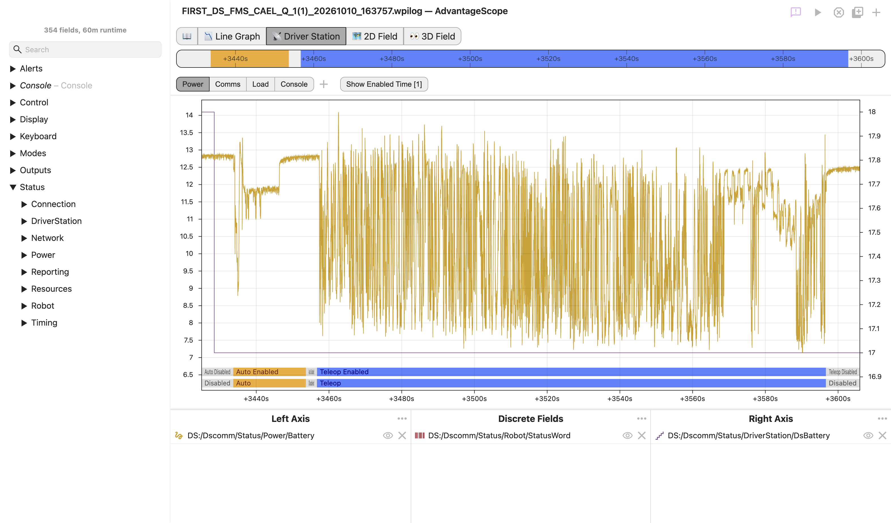
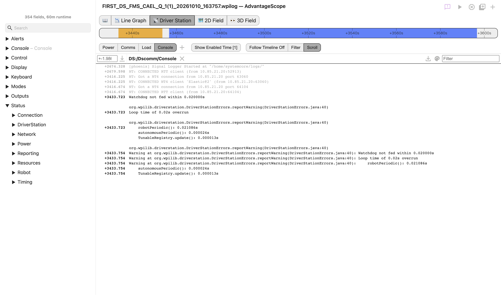

# 📡 Driver Station

The driver station tab is a preconfigured view for diagnosing logs saved by the FIRST Driver Station. It combines a set of line graphs for power, communication, and system load with the robot console, so the most common questions after a match can be answered without building a layout by hand.

:::info
This tab reads the fields saved by the FIRST Driver Station under `DS:/Dscomm`. Open a Driver Station log (WPILOG) as described on the [Log Files](/overview/log-files) page to get started. Fields that are not present in the log are shown with a strikethrough and can be ignored.
:::

## Views

Use the buttons at the top of the tab to switch between views. Each view has its own set of fields, and the selected time and timeline range are shared across all of them.

| View        | Left Axis                                | Right Axis                             | Discrete Fields           |
| ----------- | ---------------------------------------- | -------------------------------------- | ------------------------- |
| **Power**   | Robot battery voltage                    | Driver Station battery percentage      | Robot status              |
| **Comms**   | Round-trip times and average packet time | Lost packets                           | Robot state, robot status |
| **Load**    | CAN bus utilization (up to five buses)   | Robot CPU and Driver Station CPU usage | Robot status              |
| **Console** | See [below](#console)                    |                                        |                           |

The graph views work the same way as the 📉 [Line Graph](/tab-reference/line-graph) tab. Fields can be added by dragging them from the sidebar, and the color, line style, axis range, and unit conversion can be adjusted using the same controls. Changes are saved with the tab.

:::tip
Click the `+` button to add an empty graph for other fields. Graphs that were added this way can be removed using the trash icon, which appears when the graph is selected.
:::

## Robot Status

The `StatusWord` and `RobotState` fields are saved by the Driver Station as numbers. In this tab they are displayed as text, and the stripes are colored to match the robot mode shown at the bottom of the graph.

- **`DS:/Dscomm/Status/Robot/StatusWord`** is the status reported by the robot. It is displayed as the robot mode and enabled state (for example, "Teleop Enabled") along with any flags that are set, such as "E-Stop" or "Brownout".
- **`DS:/Dscomm/Status/DriverStation/RobotState`** is the state displayed by the Driver Station, which also includes connection and robot code problems (for example, "NoRobotCommunication"). This field is only saved by recent versions of the Driver Station.

| Color       | Meaning                                                 |
| ----------- | ------------------------------------------------------- |
| Gray        | Disabled, or any state without its own color            |
| Blue        | Teleop enabled                                          |
| Orange      | Autonomous enabled                                      |
| Dark gray   | Utility enabled                                         |
| Red         | Emergency stop, autonomous stop, or no radio connection |
| Brown       | Brownout                                                |
| Dark orange | No robot connection                                     |
| Yellow      | No robot communication                                  |

If an emergency stop and a brownout are both active, the emergency stop color is shown. The text under the field name includes the original number in brackets, such as `Teleop Enabled [6]`.

:::info
The Driver Station occasionally saves negative values for lost packets, which have no meaning. These are displayed as zero in this tab.
:::

## Enabled Time

Click `Show Enabled Time` to zoom the timeline to the next period when the robot was enabled, with a short margin on each side. Clicking again moves to the following period and returns to the first after the last. The button shows the displayed period and the total number of periods, such as `[2/3]`.

Autonomous and teleop are treated as a single period, from the autonomous enable to the teleop disable, when:

- The log was recorded while connected to the FMS (a real match), or
- Teleop was enabled within 15 seconds of the end of autonomous.

Otherwise, each time the robot was enabled is a separate period.

## Console

The console view shows the robot console output saved by the Driver Station, including errors, warnings, and crash reports. The controls are the same as the 💬 [Console](/tab-reference/console) tab.

The buttons on the right side of the toolbar choose how the console follows the range displayed on the timeline:

- **Follow Timeline Off:** All messages are displayed.
- **Filter:** Only messages within the timeline range are displayed.
- **Scroll:** All messages are displayed, but messages outside the timeline range are faded and the console scrolls to the start of the range.

:::tip
Use `Show Enabled Time` together with the "Filter" or "Scroll" mode to jump to the console output from a specific match or enable.
:::
